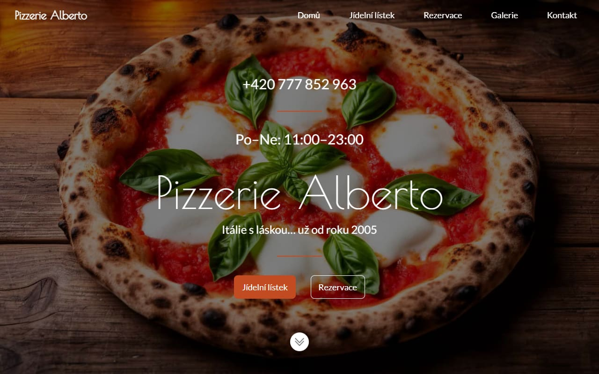
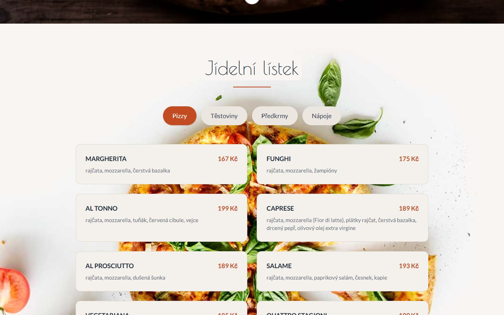
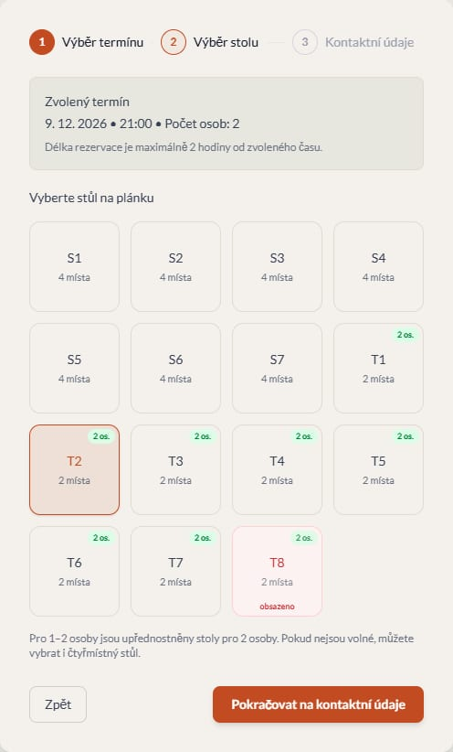
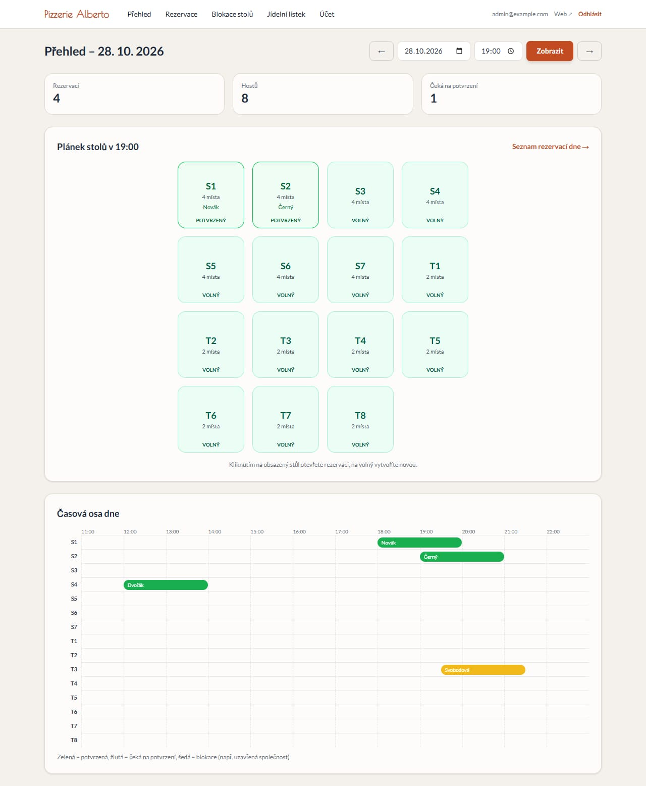
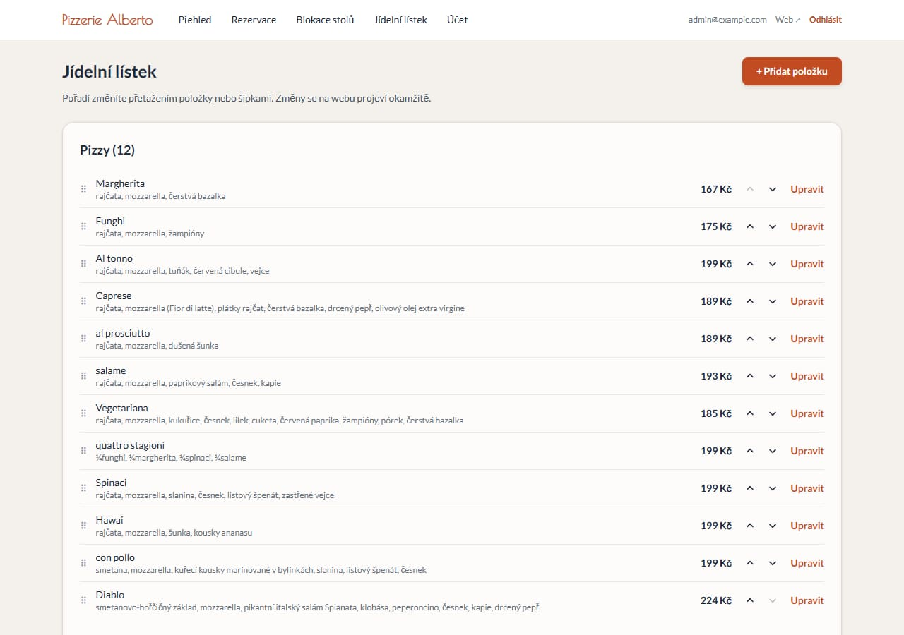

# 🍕 Pizzerie Alberto

Web italské pizzerie s online rezervací stolu a administrací pro personál.
Full-stack aplikace v **Next.js 16** s databází **Postgres**, nasazená na **Vercelu**.

**Živá ukázka: [pizzerie.dbrvsk.cz](https://pizzerie.dbrvsk.cz)**



## Co aplikace umí

### Pro hosty

- **Jídelní lístek** po kategoriích – data z databáze, takže změny z administrace jsou na webu hned.
- **Rezervace stolu ve třech krocích** – termín a počet osob → výběr stolu na plánku → kontaktní údaje.
- Plánek ukazuje **obsazenost v reálném čase**. Obsazené a blokované stoly nejdou vybrat
  a pro 1–2 osoby se nejdřív nabízejí dvoumístné stoly, aby velké zůstaly pro skupiny.
- **Potvrzení e-mailem** – rezervace je aktivní až po kliknutí na odkaz (platí 30 minut).
  Nepotvrzená rezervace stůl po vypršení automaticky uvolní.
- **Zrušení rezervace** odkazem z e-mailu kdykoli před jejím začátkem.

| Jídelní lístek | Výběr stolu |
| --- | --- |
|  |  |

### Pro personál (`/admin`)

- **Přehled dne** – plánek stolů v libovolný čas a časová osa všech rezervací dne.
  Kliknutím na obsazený stůl se otevře rezervace, na volný se rovnou založí nová.
- **Seznam rezervací** s filtrováním podle data a stavu, vyhledáváním a **exportem do CSV** (pro Excel).
- **Ruční rezervace** přijaté telefonicky, úprava, zrušení i smazání.
- **Blokace stolů** nebo celé restaurace na zvolený čas (uzavřená společnost, oprava…).
- **Správa jídelního lístku** – přidání, úprava, skrytí a **řazení přetažením myší**.





## Technologie

| Oblast | Použito |
| --- | --- |
| Framework | Next.js 16 (App Router, Server Components, Server Actions), React 19 |
| Jazyk a styl | TypeScript, Tailwind CSS 4 |
| Databáze | Postgres – [Neon](https://neon.tech) v produkci, [PGlite](https://pglite.dev) lokálně |
| Přihlášení | JWT v httpOnly cookie ([jose](https://github.com/panva/jose)), hesla přes bcrypt |
| E-maily | Nodemailer (SMTP) |
| Hosting | Vercel (serverless funkce) |

## Zajímavá technická řešení

- **Dvojí rezervace hlídá databáze, ne aplikace.** Tabulka rezervací má exclusion constraint
  nad časovým rozsahem (`tsrange`) a stolem. I když dva hosté odešlou rezervaci stejného stolu
  ve stejnou chvíli, uloží se jen jedna – druhý dostane srozumitelnou hlášku a vybere jiný stůl.
- **Odkaz v e-mailu nic nepotvrdí sám od sebe.** Potvrzení i zrušení vyžaduje kliknutí na tlačítko,
  takže rezervaci omylem nepotvrdí poštovní filtr, který odkazy v e-mailech otevírá.
  V databázi je uložený jen hash tokenu.
- **Časové pásmo.** Server na Vercelu běží v UTC, restaurace v Praze. Časy rezervací se ukládají
  v místním čase a „teď“ se vždy počítá v pásmu `Europe/Prague`, takže přechod na letní čas
  ani rozdílné pásmo serveru nic nerozbijí.
- **Databáze se připraví sama.** Při každém buildu se idempotentně vytvoří tabulky a naplní výchozí
  jídelní lístek, takže nasazení nevyžaduje žádné ruční kroky v databázi.
- **Vývoj bez cloudu.** Bez `DATABASE_URL` aplikace použije PGlite – plnohodnotný Postgres
  v procesu Node.js – včetně stejného schématu a constraintů jako v produkci.
- **Zabezpečení administrace.** Každá stránka i server action ověřuje přihlášení samostatně
  (proxy jen rychle přesměrovává), první účet lze založit jen s instalačním klíčem,
  CSV export je ošetřený proti vkládání vzorců do Excelu a rezervační formulář má past na roboty.

## Struktura projektu

```
app/
  page.tsx                 veřejný web
  actions.ts               server actions pro hosty (rezervace, potvrzení, zrušení)
  api/availability/        obsazenost stolů pro rezervační formulář
  rezervace/               stránky potvrzení a zrušení rezervace
  admin/                   přihlášení, nastavení a celá administrace
components/                části veřejného webu (rezervační průvodce, menu, galerie…)
lib/
  reservations.ts          logika rezervací a blokací
  menu.ts                  jídelní lístek
  auth.ts, session.ts      přihlášení
  db.ts                    připojení k Neonu / PGlite
db/schema.mjs              schéma databáze
scripts/db-setup.mjs       příprava databáze při buildu
```

## Spuštění lokálně

```bash
npm install
npm run dev
```

Otevřete [localhost:3000](http://localhost:3000). Data se ukládají do lokální databáze ve složce `.pglite`
a e-maily se místo odeslání vypisují do konzole. Účet administrátora vytvoříte na `/admin/setup`.

## Nasazení na Vercel

1. Importovat repozitář do Vercelu.
2. Ve **Storage** připojit databázi **Neon** – nastaví proměnnou `DATABASE_URL`.
3. Doplnit proměnné prostředí podle [`.env.example`](.env.example)
   (`SESSION_SECRET`, `SETUP_KEY`, `SMTP_USER`, `SMTP_PASS`).
4. Nasadit – tabulky a jídelní lístek se vytvoří automaticky.
5. Na `/admin/setup` založit administrátora pomocí `SETUP_KEY`.

## Historie

Projekt vznikl jako přepis dvou mých starších aplikací – webu pizzerie s PHP administrací
nad MySQL a samostatného rezervačního systému (PHP, SQLite, PHPMailer). Spojil jsem je do jedné
aplikace, která běží bez vlastního serveru, a při tom opravil několik chyb a bezpečnostních slabin původní verze.
